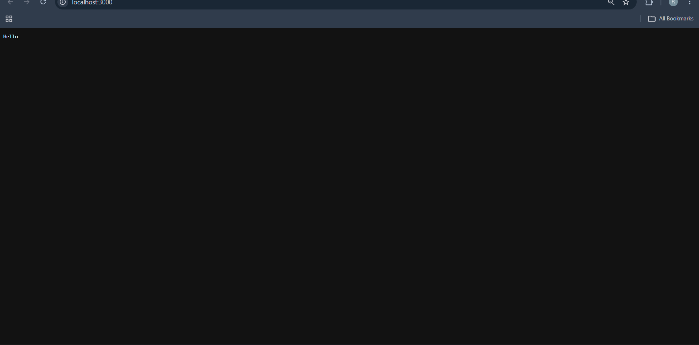
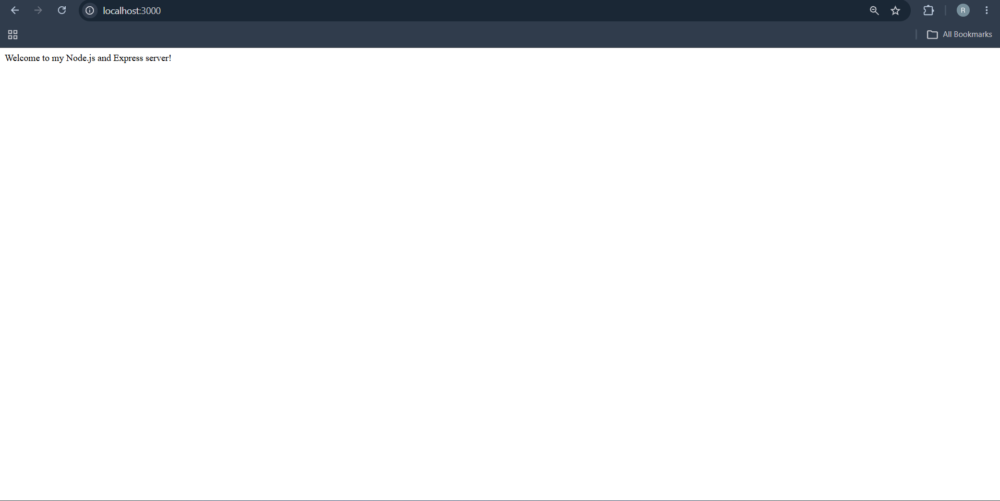
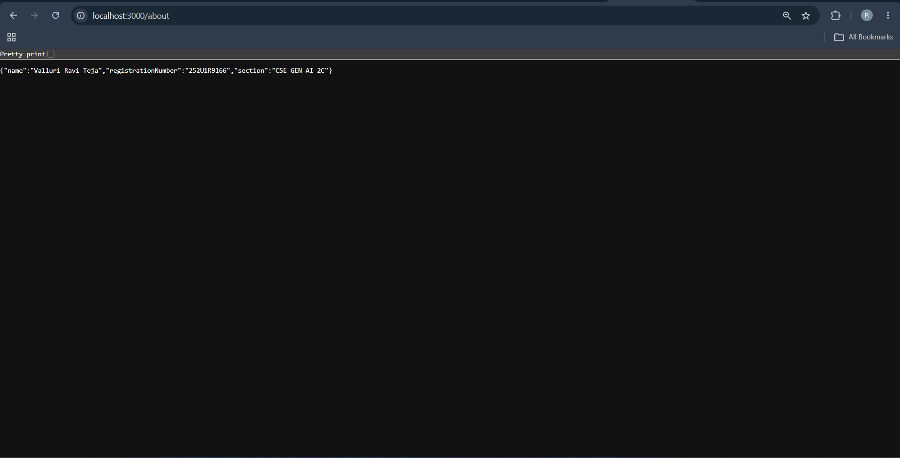
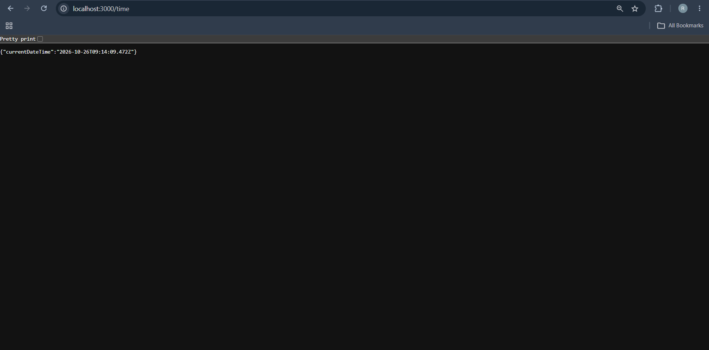
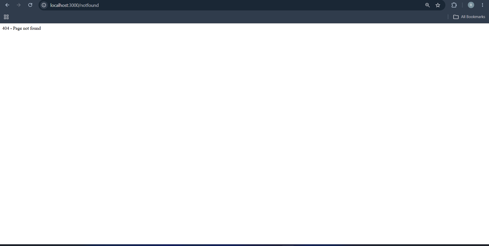

# Backend Development Fundamentals – Lab 1: Node.js and Express Server

## Student Details
- **Name:** Valluri Ravi Teja
- **Registration Number:** 252U1R9166
- **Section:** CSE GEN-AI 2C
- **GitHub Repository:** [https://github.com/ravitejavalluri207-dotcom/BDF-lab-01](https://github.com/ravitejavalluri207-dotcom/BDF-lab-01)

---

## Objective
The objective of this lab is to:
1. Build a basic web server using Node.js's built-in `http` module.
2. Develop a REST API server using the **Express.js** framework.
3. Understand routing and HTTP status codes (`200 OK`, `404 Not Found`).
4. Implement dynamic configuration using environment variables (`process.env.PORT || 3000`) for deployment compatibility.
5. Manage dependencies and establish proper Git hygiene by excluding `node_modules/` and `.env` using `.gitignore`.

---

## Project Structure
```text
lab-01/
├── node_modules/          # Local dependencies (ignored by git)
├── screenshots/           # Output verification screenshots
│   └── .gitkeep
├── .gitignore             # Git ignore file (excludes node_modules, .env)
├── package.json           # Project manifest and scripts
├── package-lock.json      # Dependency lock file
├── README.md              # Project documentation and lab report
├── server-http.js         # Basic HTTP server using built-in http module
└── server.js              # Express.js REST API server
```

---

## Prerequisites
- **Node.js** (v18.x or later installed)
- **npm** (Node Package Manager)
- **Git**

---

## Installation & Setup

1. **Clone the repository:**
   ```bash
   git clone https://github.com/ravitejavalluri207-dotcom/BDF-lab-01.git
   cd BDF-lab-01
   ```
   *(Or navigate into `lab-01` if cloned as part of a multi-directory setup)*

2. **Install dependencies:**
   ```bash
   npm install
   ```

---


## API Endpoints & Expected Status Codes

| Endpoint | Method | Description | Status Code | Expected Response |
| :--- | :--- | :--- | :--- | :--- |
| `http://localhost:3000` (`server-http.js`) | GET | Built-in HTTP module greeting | `200 OK` | `Hello` |
| `/` (`server.js`) | GET | Express welcome message | `200 OK` | `Welcome to my Node.js and Express server!` |
| `/about` (`server.js`) | GET | Student information (Name, Reg No, Section) in JSON | `200 OK` | `{"name":"Valluri Ravi Teja","registrationNumber":"252U1R9166","section":"CSE GEN-AI 2C"}` |
| `/time` (`server.js`) | GET | Current server timestamp generated via `new Date()` | `200 OK` | `{"currentDateTime":"2026-10-26T08:53:59.459Z"}` |
| Any undefined route (e.g. `/random`) | GET / Any | Catch-all handler for unknown routes | `404 Not Found` | `404 - Page not found` |

---

## Screenshots


## Screenshots

### 1. Built-in HTTP Server Output (Port 3000)


### 2. Express Server - GET /


### 3. Express Server - GET /about


### 4. Express Server - GET /time


### 5. Express Server - 404 Route Not Found



## Problems Faced & Solutions

1. **Problem:** `node_modules/` was previously committed into the Git repository, bloating repo size and cluttering commits.
   - **Solution:** Created a `.gitignore` file specifying `node_modules/` and `.env`, and untracked the folder from Git cache using `git rm -r --cached node_modules` while keeping local dependencies intact.

2. **Problem:** Port was hardcoded to `3000`, which could cause port collision or failure when deploying to cloud hosting services.
   - **Solution:** Updated `server.js` and `server-http.js` to read `process.env.PORT || 3000`.

3. **Problem:** Undefined routes would return Express default HTML 404 responses instead of a concise, controlled error message.
   - **Solution:** Added a terminal catch-all middleware (`app.use`) returning status `404` with `"404 - Page not found"`.
